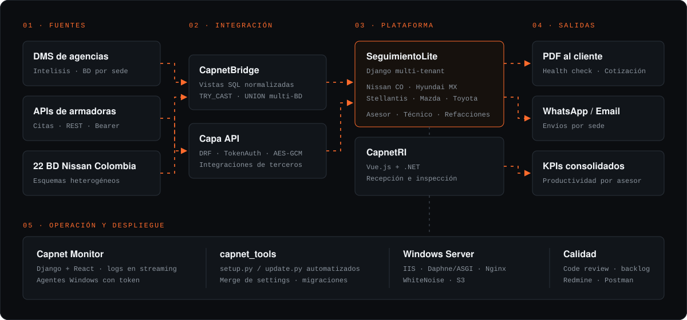

<!-- Portada del perfil de GitHub: repo Riay/Riay -->

<p align="center">
  
</p>

<p align="center">
  
</p>

<p align="center">
  <a href="https://www.linkedin.com/in/yair-silva-mendoza-8045266b"></a>
  <a href="mailto:yairs.mendoza@hotmail.com"></a>
  
  <br/>
  
  
</p>

---

## `$ whoami`

Gerente de Desarrollo en **Capital Network (Capnet)**. Dirijo el desarrollo y la operación de **SeguimientoLite**, la plataforma de postventa que usan agencias de **Nissan, Hyundai, Stellantis, Mazda y Toyota** en **México, Colombia y Ecuador**: seguimiento de órdenes de servicio, cotizaciones, inspecciones, evidencias y comunicación con el cliente.

Antes fui **Tech Lead en Inetum** para cuentas de **Walmart** y **DHL**: dirigí equipos con Scrum y diseñé desde cero la arquitectura de una solución con login por QR, OCR y verificación facial. Me formé como desarrollador full-stack en **Skylab Coders Academy, en Barcelona (España)**, y soy **Ingeniero en Sistemas Computacionales**.

Combino gestión y ejecución técnica: defino arquitectura, coordino equipos y proveedores, priorizo backlog, reviso código y me aseguro de que lo que sale a producción funcione.

```yaml
rol:          Gerente de Desarrollo · Tech Lead · Full-Stack
experiencia:  9+ años en TI y desarrollo (desde 2017)
actual:       Gerente de Desarrollo en Capital Network · Consultor externo en TELMEX/MACC (Banco del Bienestar)
antes:        Inetum (Walmart, DHL) · Capital Network · SSM · Carvajal
formación:    Ing. Sistemas Computacionales · Bootcamp Full-Stack Skylab Coders (Barcelona)
alcance:      México · Colombia · Ecuador
enfoque:      Arquitectura · Liderazgo de equipos · Integraciones · Operación de sistemas críticos
```

---

## Impacto

<table>
  <tr>
    <td width="50%" valign="top">

**Plataforma multi-marca en producción**<br/>
Una sola base Django desplegada por cliente, con configuración por tenant (prefijos, rutas, vistas SQL por esquema) para 5 marcas en 3 países.

  </td>
    <td width="50%" valign="top">

**Datos de 22 agencias en un solo lugar**<br/>
Base de KPIs consolidada para la red Nissan Colombia: vistas `UNION` sobre ~22 BD con esquemas distintos, productividad por asesor y envíos por sede.

  </td>
  </tr>
  <tr>
    <td valign="top">

**Despliegue y monitoreo automatizados**<br/>
`capnet_tools` (setup/update con merge de configuración, migraciones y fallback de dependencias) y **Capnet Monitor**: panel central con agentes Windows para disparar y auditar actualizaciones.

  </td>
    <td valign="top">

**Estabilidad en producción**<br/>
Logs ASGI bajados de **800k+ líneas/hora** a solo advertencias reales. Cifrado unificado en **AES-GCM** en API y generación de PDF.

  </td>
  </tr>
  <tr>
    <td valign="top">

**Integraciones con terceros**<br/>
APIs de citas de armadoras y proveedores (5 endpoints, auth Bearer): plan de 3 semanas, colección Postman con token automático y entrega al equipo.

  </td>
    <td valign="top">

**Gestión del equipo y backlog**<br/>
Clasificación de incidencias por dependencia (desarrollo, bloqueo externo, QA, cierre) y carga por persona y cliente. Además, recordatorios automáticos y escalamiento de tickets estancados desde Capnet Agenda.

  </td>
  </tr>
</table>

---

## Proyecto insignia

<p align="center">
  
</p>

**Capnet Agenda** es la agenda, el control de ausencias y la coordinación diaria de todo el equipo de Capnet en México y Colombia. La diseñé y construí de punta a punta.

- **Reglas de negocio:** valida que nadie tenga dos sesiones a la misma hora (sesiones, comida, jornada por día, ausencias y festivos). En las series valida todas las fechas juntas, y un horario sin responder también se aparta.
- **Integración con Slack:** se entra con la cuenta de Slack (OAuth), hay comando `/agendar` con modal y pestaña Inicio. La tarjeta de cada sesión trae botones de asistencia y avisa 5 min antes. El estado cambia solo a "En sesión" o "Comiendo".
- **Correo e iCal:** manda invitaciones `.ics` que Outlook y Gmail muestran con botones Sí/No/Quizá, y lee las respuestas por IMAP. Las invitaciones externas reenviadas al buzón (Zoom, Teams, Meet, también recurrentes) se registran solas.
- **Recursos humanos:** solicitudes de vacaciones con aprobación de gerente, Dirección y Capital humano. Lleva el saldo conforme a la **LFT (art. 76)** y al **CST (art. 186)**, con festivos MX/CO y expedientes con versiones, vencimientos y bitácora.
- **Redmine:** muestra los tickets asignados a cada persona y permite apartar tiempo para atenderlos. Manda un recordatorio diario de peticiones sin movimiento y escala al gerente a los 2 días hábiles.
- **Portal de citas público:** el cliente entra con un código por correo y agenda con su consultor. Los prospectos van con el área comercial, y la reunión de Zoom se crea sola.
- **API REST v1:** llaves por aplicación, límite de 120 peticiones por minuto, bitácora y errores tipados (`409 horario_ocupado`), para que otros sistemas internos agenden con las mismas reglas.
- **Operación:** corre en Windows Server con Waitress, NSSM, SQL Server y TLS. Los tokens se guardan cifrados, los envíos a Slack pasan por una cola con reintentos y la interfaz se actualiza casi en tiempo real.

---

## Arquitectura que lidero

<p align="center">
  
</p>

---

## Proyectos destacados

> Son sistemas de cliente en repositorios privados. Puedo mostrar arquitectura, decisiones y demos en entrevista.

| Proyecto | Qué resuelve | Stack | Mi rol |
|---|---|---|---|
| **SeguimientoLite** | Seguimiento de la orden de servicio: asesor, técnico, refacciones, mano de obra, cotización y health check en PDF | Django · DRF · SQL Server · jQuery · S3 | Líder técnico y arquitectura |
| **CapnetRI** | Recepción e inspección del vehículo en piso de taller, desde tablet | Vue.js · .NET | Revisión y corrección de flujo crítico |
| **CapnetBridge** | Normaliza datos del DMS (Intelisis) en vistas SQL listas para la plataforma | SQL Server · T-SQL | Diseño de vistas e integración |
| **KPIs Nissan Colombia** | Indicadores consolidados de ~22 agencias en una sola base | SQL Server | Modelo de datos y vistas |
| **Capnet Agenda** | Agenda, ausencias, vacaciones y coordinación del equipo MX/CO con Slack, Zoom, Redmine y correo | Django 5 · SQL Server · Slack SDK · iCal · Zoom API | Arquitectura y desarrollo completo |
| **Reinvención de Tableros V4 · Hyundai** | Tableros de taller heredados (VB.NET) rehechos sobre SeguimientoLite para Hyundai México | Django · SQL Server · JS | Rediseño y migración |
| **Capnet Monitor** | Panel central que ve el estado de los servidores Windows de cada cliente, lanza actualizaciones con confirmación y muestra el log en vivo | Django · React · agentes Python con token | Diseño y desarrollo |
| **Crepas Jhonn Coffee · Bot de pedidos** | Pedidos por WhatsApp con menú web personalizado, monitor de cocina en tiempo real y comprobante PDF | Django 5 · WhatsApp Cloud API · Channels · Celery · Redis · PostgreSQL | Arquitectura y desarrollo completo |
| **capnet_tools** | Instalación y actualización reproducible en Windows Server | Python · Git · Playwright | Diseño y desarrollo |
| **Citas Web** | Agenda de citas integrada con APIs de armadoras | Django · REST | Planeación e integración |

### Fuera del automotriz: comercio por WhatsApp

**Crepas Jhonn Coffee:** bot de pedidos para una cafetería.

```text
WhatsApp ─▶ bot (Cloud API) ─▶ enlace personal al menú web ─▶ carrito y personalización
        ─▶ pago en efectivo ─▶ monitor de cocina por WebSocket ─▶ "tu pedido está listo" + ticket PDF
```

- **Monitor de cocina (KDS):** los pedidos llegan con sonido y pasan por Nuevos, Preparando, Listos y Entregado. Desde ahí se activan o desactivan los ingredientes del día, y lo que se acaba aparece como "Agotado" en el menú del cliente.
- **Bot:** saluda con promociones (máximo una vez cada 12 h por cliente), informa el estado del pedido y pasa la conversación a una persona cuando hace falta.
- **Seguridad:** valida la firma HMAC `X-Hub-Signature-256` de cada mensaje y no duplica pedidos si Meta reintenta (idempotencia por `message_id`). Bloquea cada conversación con `select_for_update` y recalcula los precios en el servidor. El WebSocket solo acepta personal y valida el Origin, y hay un límite de 5 pedidos cada 10 min por cliente.
- **Asíncrono y pruebas:** Celery con reintentos para confirmaciones, avisos y tickets. Tiene 51 pruebas automatizadas.

### Públicos

| Repo | Descripción | Stack |
|---|---|---|
| [Gestor-de-Tareas](https://github.com/Riay/Gestor-de-Tareas) | Gestión de tareas, avance de proyectos y carga de trabajo por desarrollador | JavaScript · Node.js · Express · SQLite |
| [Corpocloud](https://github.com/Riay/Corpocloud) | App Android de notas con almacenamiento local | Java · SQLite |
| [SaludInteligente_RIAYTECH](https://github.com/Riay/SaludInteligente_RIAYTECH) | Investigación y app móvil de salud (TECMILENIO) | Java · Android |

---

## Stack

<p align="center">
  <br/>
  <br/>
  
</p>

<p align="center">
  
  
  
  
  
  
  
  
  
  
  
  
  
</p>

---

## Experiencia

```text
HOY  ──◉── CAPITAL NETWORK ·········· Gerente de Desarrollo
       │   SeguimientoLite, Capnet Agenda, Monitor · Toyota, Hyundai, Nissan · MX / CO / EC
       │
HOY  ──○── TELMEX / MACC ············ Consultor externo · Tecnología y Desarrollo  (en paralelo)
       │   Proyectos Banco del Bienestar · implementación de telefonía, servidores y cableado
       │
2023 ──●── INETUM HOLDING MÉXICO ···· Tech Lead / Líder Técnico de Desarrollo   (2023–2025)
       │   Walmart · DHL
       │
2020 ──●── CAPITAL NETWORK ·········· Coordinador de Soporte y Sistemas         (2020–2023)
       │   Toyota, Hyundai, Nissan · soporte México y Ecuador (Mavesa)
       │
2018 ──●── SYSTEM SAFETY DE MÉXICO ·· Soporte técnico y sistemas                (2018–2020)
       ●── HICKOK (Laboratorios) ···· Facturación y sistemas administrativos    (2018)
       │
2017 ──●── CARVAJAL TECNOLOGÍA ······ Implementador Jr.                         (2017–2018)
       ●── SKYLAB CODERS ACADEMY ···· Bootcamp Full-Stack · Barcelona, España
```

<details open>
<summary><b>Capital Network</b>: Gerente de Desarrollo (2026 – hoy)</summary>

- Dirijo el desarrollo y la operación de la plataforma de postventa en agencias de **Toyota, Hyundai, Nissan, Stellantis y Mazda**.
- Arquitectura e implementación de **Capnet Agenda**, **Capnet Monitor**, CapnetBridge y la reinvención de Tableros V4 para Hyundai.
- Coordino el soporte en **México, Colombia y Ecuador** y llevo incidentes críticos, mantenimientos, prioridades y proveedores.
- Bases de datos SQL Server multi-agencia, control de accesos y continuidad operativa.
</details>

<details open>
<summary><b>TELMEX / MACC</b>: Consultor externo de Tecnología y Desarrollo (actual, en paralelo)</summary>

- Consultoría externa de tecnología y desarrollo para los proyectos del **Banco del Bienestar**.
- Líder de implementación de sistemas: telefonía y centrales de llamadas, servidores e infraestructura TI.
- Diseño y supervisión de **cableado estructurado** y puesta en marcha de sitios.
</details>

<details open>
<summary><b>Inetum Holding México</b>: Tech Lead / Líder Técnico de Desarrollo (2023 – 2025)</summary>

**Walmart**
- Lideré el desarrollo y la evolución de aplicaciones en producción: nuevas funcionalidades y mantenimiento correctivo.
- Coordiné desarrolladores con Scrum (dailies y sprints) y gestioné historias de usuario en Jira, con planeación de entregas.
- Documentación técnica y funcional para liberaciones; enlace entre áreas técnicas y de negocio.

**DHL**
- Diseñé el modelo de datos y la arquitectura de la solución.
- Desarrollé un login con código QR, módulos de **OCR** y **verificación facial** con SDK.
</details>

<details>
<summary><b>Capital Network</b>: Coordinador de Soporte y Sistemas (2020 – 2023)</summary>

- Operación de sistemas para Toyota, Hyundai y Nissan; soporte técnico en México y Ecuador (Mavesa).
- Administración de bases de datos SQL y plataformas internas; mejoras funcionales con Django, Python y JavaScript.
- Gestión de tickets e incidentes críticos, control de accesos y documentación de procesos.
</details>

<details>
<summary><b>SSM · Hickok · Carvajal</b>: Infraestructura, soporte e implementación (2017 – 2020)</summary>

- **System Safety de México:** soporte técnico, redes, cableado estructurado y CCTV.
- **Hickok (Laboratorios Biology):** facturación y sistemas administrativos.
- **Carvajal Tecnología y Servicios:** implementador Jr.
</details>

---

## Formación

<table>
  <tr>
    <td width="50%" valign="top">

**Skylab Coders Academy · Barcelona, España**<br/>
<sub>2017 · Full-Stack Development Bootcamp</sub>

Bootcamp intensivo presencial de desarrollo full-stack con JavaScript en Barcelona: proyectos en equipo, metodologías ágiles y estándares de la industria europea. Ahí empezó mi carrera como desarrollador.

  </td>
    <td width="50%" valign="top">

**Ingeniería en Sistemas Computacionales**<br/>
<sub>Tecnológico Universitario Naucalpan · 2015 – 2020 · Concluida</sub>

**Técnico en Informática**<br/>
<sub>CETIS No. 8 "Rafael Donde" · 2011 – 2014</sub>

**Cursos:** Desarrollo Web (certificado por Google) · Codecademy · Udemy · Desarrollo de apps móviles (TECMILENIO)

  </td>
  </tr>
</table>

**Idiomas:** español nativo · inglés técnico / intermedio

---

## Actividad

<p align="center">
  
</p>

<p align="center">
  
</p>

---

## Contacto

| | |
|---|---|
| **Email** | [yairs.mendoza@hotmail.com](mailto:yairs.mendoza@hotmail.com) |
| **LinkedIn** | [yair-silva-mendoza-8045266b](https://www.linkedin.com/in/yair-silva-mendoza-8045266b) |
| **Ubicación** | CDMX · disponible para trabajo remoto y reubicación |

<p align="center">
  <sub>¿Buscas a alguien que lleve un producto de la arquitectura a producción y sostenga al equipo en el camino? Escríbeme.</sub>
</p>
